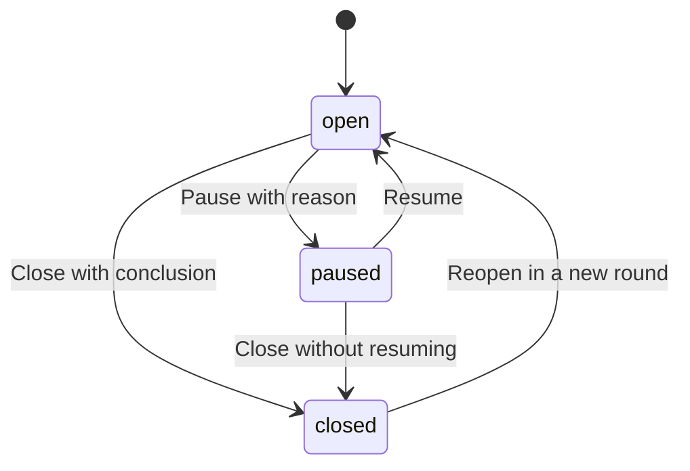

# Investigation lifecycle

An investigation answers one concrete question and leaves behind only what is still useful: the method, the decisions,
the results and the deliverables in use. This skill keeps its folder in a known shape at every step.

## When to use

- Starting an investigation, or a phase of one.
- Changing its state: pause, resume, close, reopen, or move it to its own repository.
- Writing one of its documents: README, framework, decisions, phase note, installed log or synthesis.

If the knowledge base has its own rules for investigations (an `AGENTS.md` in the folder, a template, fixed file names
or field names in another language), those win. This skill fills only what they leave unsaid.

## Types

Declare the type in the README; it decides which documents the folder needs.

| Type | What it does | Conclusion comes from |
| --- | --- | --- |
| Documentary | Compares options by reading their official documentation. Installs and measures nothing | The documentation |
| Experimental | Installs, runs and measures | Data obtained on the user's machine |

An investigation that ends with something installed and in use is experimental. If a documentary one finds that the
documentation is not enough, close its documentary round and reopen it as an experimental round; do not switch type
halfway.

## Documents

One folder per investigation, named like the README title.

| Document | Documentary | Experimental | Content |
| --- | --- | --- | --- |
| `README.md` | Required | Required | Status notice, goal and question, type, conclusion, reading order |
| Framework | `Framework.md` | `Phase 1 - Framework and Criteria.md` | Scope, what is left out, constraints, criteria, machine, phases used |
| `Comparison.md` | Required | Optional | Candidate profiles and comparison table |
| `Phase N - Title.md` | No | One per phase | Method, execution, results and what passes to the next phase |
| `Decisions.md` | Required | Required | What was chosen, discarded or is still open |
| `TODO.md` | Optional | Optional | Pending work outside the phases; completed items are deleted, not ticked |
| `Installed.md` | No | From the first install | Every program installed, how to remove it and its status |
| `Synthesis.md` | At closing | At closing | Method, phases, results and final comparison, condensed |

Supporting notes with descriptive names are allowed and listed in the reading order. One still in use after closing
(a guide, a production setup, a diagnosis) is a **deliverable**: mark it "(deliverable)" and keep it when closing.

The README holds only the notice, one paragraph with the goal and question, the type, the conclusion ("Pending" while
open) and the numbered reading order with links. Scope, criteria and data live in the documents it links. Its
frontmatter carries `type` (`documentary` or `experimental`) and `status` (`open`, `paused` or `closed`).

Every decision has three parts: **Decision**, **Reason** (with the data behind it) and **Revisit when** (a concrete
condition). An open decision is marked "(open)" and lists the options and what is missing to decide.

Templates for every document are in `references/templates.md`.

## Phases

Only experimental investigations have phases. The framework says which ones are used, merged or skipped, and why.

| Phase | Content | Output |
| --- | --- | --- |
| 1. Framework and criteria | Scope, constraints, criteria, machine, test sample | Frozen criteria |
| 2. Candidates and viability | Inventory; discard what breaks a constraint | Short list |
| 3. Method | Setup, test data and measurement scripts | Reproducible procedure |
| 4. Execution and measurement | Run the method on the short list | Results table |
| 5. Validation | Check results by hand, in real use or on a second sample | Confirmed or corrected results |
| 6. Recommendation | Final comparison against the criteria | README conclusion |

A phase repeated with another sample or candidate set is a round: `Phase N - Round M - Title.md`. Each phase note
opens with what it looks for and ends with what it obtained and what passes on.

Once the next phase has started, the criteria are not changed to favor a candidate. A change of criteria goes into
`Decisions.md` with its reason.

## States

The `status` field, the notice at the top of the README and any index or dashboard that lists investigations must
agree. Update all three in the same change. Only one notice at a time: each new state replaces the previous one.

## Procedure

### Start

1. Create the folder and, first, the README: goal, question, type, `status: open`, conclusion "Pending", and the
   reading order with the documents already known to exist. No notice yet.
2. Write the framework. Nothing is searched or measured without it.
3. Create `Decisions.md`, even with only the scope decision.
4. Add the investigation to the knowledge base's index, if there is one.

### Pause

Set `status: paused` and write the notice with the date, a reason from this list, one sentence that makes it concrete,
and the condition that unblocks it: **insufficient information**, **changed situation**, **redefined scope**,
**external blocker** or **priority**.

### Resume

1. Reread the README, `Decisions.md` and `TODO.md` before writing anything.
2. Check every "Revisit when" in `Decisions.md`. If a condition has been met, revisit that decision first.
3. Set `status: open` and replace the pause notice with a resume notice that keeps the date and reason of the pause.

### Close

An investigation closes when all five hold:

1. A conclusion is written in the README, even if it is that no option works or the question stopped mattering.
2. `TODO.md` is empty: each item is done, moved to the repository where the work continues, or marked out of scope
   in the framework. An empty `TODO.md` is deleted after the user confirms.
3. `Synthesis.md` is written (below).
4. Cleanup is done and validated (below).
5. `status: closed` and a closing notice with the date, the conclusion in one sentence and where the work continues.

**Synthesis.** It condenses everything that cleanup deletes, so the investigation can be reopened without the
original notes: the method (machine, versions, commands or scripts needed to repeat it), one paragraph per phase,
the key figures with source and date, and the final comparison table against the framework's criteria with each
discarded candidate and its reason in one line. It links the framework and decisions instead of repeating them.

**Cleanup.** Keep the README, the framework, `Decisions.md`, `Synthesis.md`, `Installed.md` and the deliverables.
Delete the rest: phase notes, `Comparison.md`, supporting notes that are not deliverables, extracted assets, source
files and test data. Version control keeps the history.

1. **Propose** four lists before touching anything: what is deleted, what is condensed into the synthesis, what is
   kept, and the software to uninstall or keep (from `Installed.md`). Include the notes elsewhere that link to files
   being deleted and where each link will point instead, usually the synthesis.
2. **Wait for the user** to confirm, adjust or reject each list.
3. **Execute**: write the synthesis, rewrite incoming links, delete the approved files and update the reading order.
4. **Uninstall** the approved software the same way it was installed, including the data it leaves in the user's
   library folders if the user approves. Never touch what stays in use. Mark each row of `Installed.md` "Kept in use"
   or "Uninstalled on YYYY-MM-DD".
5. **Report** what was done so the user can review it before committing.

### Reopen

Reopening is a new round in the same folder, not a new investigation.

1. Reread the README, framework, decisions, synthesis and `Installed.md`. Recover a note deleted at closing from
   version control instead of rewriting it.
2. Set `status: open` and replace the closing notice with a reopening notice: date, previous closing date, reason
   and round number.
3. If the round changes scope or criteria, update the framework and record the change in `Decisions.md`.
4. New phases continue the numbering, or are named as rounds when they repeat a phase.
5. Keep the previous conclusion in the README, marked with its round, until the new round confirms or replaces it.

### Move to its own repository

When the next step is to **build** something (a tool, code too large for blocks in a note) rather than decide:

1. Create the repository following the user's project bootstrap procedure, if they have one.
2. Turn the scripts from the phase notes into files of the repository. The notes keep the method and results; the
   current code lives only in the repository.
3. Close the investigation; pending items go to the repository's own TODO and the closing notice links the
   repository.
4. If the knowledge base keeps project notes next to each repository, move the folder there with the user's
   confirmation, update its frontmatter and tags, rewrite the links in and out, and move its entry in the index.

From then on, findings are documented in the repository. If a new result contradicts the conclusion, reopen the
investigation instead of correcting it silently.

## Installed log

Update `Installed.md` **at the moment of installing**, not at the end. One row per program, extension, dependency or
helper tool: name and version, machine, method (`brew`, `pip`, extension store, installer, container), the exact
uninstall steps including leftover data, and status ("Under test" while open).

## Rules

- Every volatile figure (version, price, quota, plan limit) carries its source and the date it was checked.
- Every measurement carries machine, software version, command and date. A figure without those four is not used to
  decide.
- What could not be determined is written as such, never estimated silently.
- Technical documentation is read from the official source or a documentation tool, not from memory.
- Measurement scripts live in fenced code blocks inside the phase note, with the exact command and its output, unless
  the knowledge base allows code files. Code that outgrows blocks is a sign to move to a repository.
- Never delete notes, uninstall software or remove data without the user's explicit approval of the list.
- Do not run git. Leave the changes for the user to review and commit.

## References

- `references/templates.md`: read it when creating any document of an investigation, to copy its skeleton.
